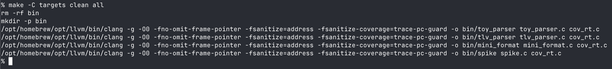
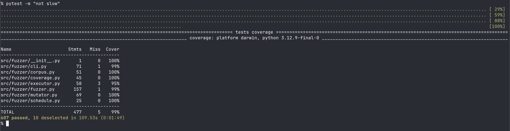
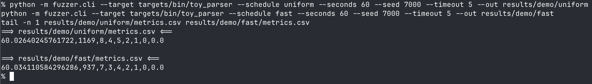
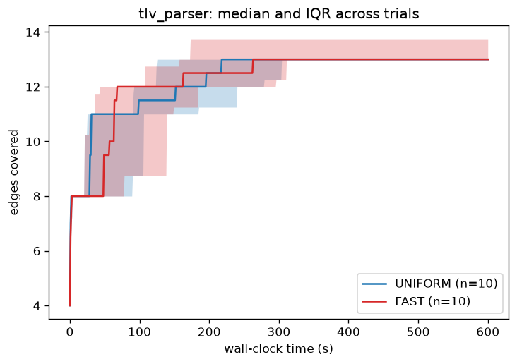
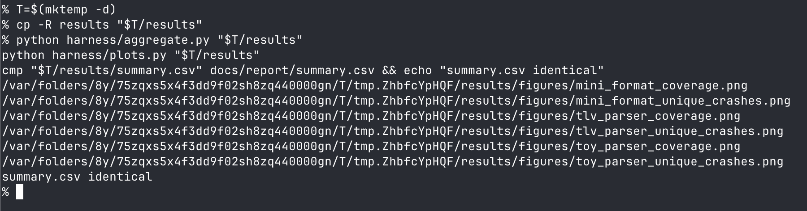

# AFLFast Reproducer

Tuan · Computer Security, Syracuse University · Fall 2026

A naive coverage-guided greybox fuzzer (AFL-style) that **tests whether AFLFast's
power schedule (FAST) beats a uniform schedule (UNIFORM)**, under the
**evaluation methodology of Klees et al.**

- **What it tests:** AFLFast's (CCS 2016) claim that spending more energy on
  rare-path seeds beats uniform energy allocation.
- **How it measures it:** _Evaluating Fuzz Testing_ (CCS 2018) — repeated trials,
  Mann-Whitney U significance, A12 effect size, honest crash de-duplication.

See **[`docs/PRD.md`](https://github.com/tuannguyen-TN/AFLFast-reproducer/blob/v1.1-submission/docs/PRD.md)** for the full requirements and **`CLAUDE.md`** for the repo map,
commands and working agreement. The development process (roles, tickets, SDLC)
lives in **`.claude/agents/`** and **[`tickets/`](https://github.com/tuannguyen-TN/AFLFast-reproducer/tree/v1.1-submission/tickets)**; `.claude/` and `CLAUDE.md` are not needed to build, run or test the fuzzer.

**Result.** H1 is not supported: on none of the six pre-registered primary endpoints did FAST differ from
UNIFORM at Holm-adjusted p < 0.05 (all adjusted p = 1). See the committed summary,
[`docs/report/summary.md`](https://github.com/tuannguyen-TN/AFLFast-reproducer/blob/v1.1-submission/docs/report/summary.md).

AI coding agents (Claude Code) wrote nearly all of the code, working in roles I defined; a small part came in with the first commit. From 14 November, an AI assistant (Claude) made day-to-day lead decisions. I approved every commit and push.

## Quickstart

Reproduce the frozen main campaign, then the analysis. Run everything from the repository root.

**From the submission zip:** the install, build, test and Demo steps 1–3 work as written. The main
campaign (its `--freeze-commit` check reads git history) and Demo step 4 (it needs the raw-data archive
and `docs/report/`) need a git clone: `git clone https://github.com/tuannguyen-TN/AFLFast-reproducer`,
then `git checkout v1.1-submission`.

**Prerequisites.** Python >= 3.10 (tested with 3.12.9). On macOS, Homebrew LLVM (`brew install llvm`;
tested with Homebrew clang 23.1.5): Apple clang's ASan hangs on macOS 26.x (ADR-0001). The Makefile
uses `/opt/homebrew/opt/llvm/bin/clang` if that file exists. Otherwise it silently falls back to
`clang` on `PATH`, which on macOS is Apple clang and hits the hang. To choose the compiler yourself,
pass `CC`, for example `make -C targets CC="$(brew --prefix llvm)/bin/clang" clean all`.
Tested only on macOS on Apple silicon (arm64); other platforms are untested.

```bash
python -m venv .venv && source .venv/bin/activate
pip install -r requirements.txt
pip install -e .   # makes `python -m fuzzer.cli` work from the repo root
make -C targets clean all   # not a plain `make -C targets`: targets/bin/* do not depend on the Makefile (AFL-011)
pytest -m "not slow"   # fast test suite (plain `pytest` is the same: pyproject.toml sets -m "not slow"); `pytest -m slow` runs the slow tests
```

Keep the venv active in every shell you use for the commands below; `python -m fuzzer.cli` and the
`harness/` scripts need it.

Contributors only (not needed to run anything): enable the tracked commit-msg hook (ticket-id check).
This is local git configuration and does not travel with a clone.

```bash
git config core.hooksPath .githooks
```

Then, on a clean tree whose HEAD descends from the freeze commit
`ff19bef7abb57b1ccbffd0318e2bbcb3c13f9cfc` (recorded in AFL-011's Log, entry "2026-11-17 — freeze hash"):

```bash
python harness/run_campaign.py experiments/configs/main.yaml --kind main \
    --freeze-commit ff19bef7abb57b1ccbffd0318e2bbcb3c13f9cfc
python harness/aggregate.py results/
python harness/plots.py results/
```

The campaign (3 targets x 2 schedules x 10 trials, 600 s each, concurrency 3) took about 3 h 20 min on
the machine used. It ran with the macOS crash reporters turned off; see AFL-011's Log in `tickets/` for
how. `aggregate.py` and `plots.py` gained input guards after the freeze (AFL-033, commit `ee0ac4b`); the
published analysis ran with that version. It is in `docs/report/`; `docs/report/PROVENANCE.md` has
hashes and times. The raw-data archive (`aflfast-results-ff19bef.tar.gz`) is kept off the repository
because it contains local paths; its manifest `data/SHA256SUMS` is committed; the archive is available
from the author on request. To check it, extract the archive into a fresh empty
directory, copy `data/SHA256SUMS` and the archive into that directory, and run
`shasum -a 256 -c SHA256SUMS` there. Without the archive you can still re-run the campaign.

**Crash reporters.** The main campaign ran with both macOS crash reporters off: the per-user agent
`com.apple.ReportCrash` and the system daemon `com.apple.ReportCrash.Root`. They cost CPU on every
crash (the PRD records that this "slows the trials and so would bias the item (d) comparison"), and
they could penalise the arm that crashes more. AFL's `afl-fuzz` (`check_crash_handling()` on
macOS, kept in AFLFast) refuses to run while the per-user `com.apple.ReportCrash` agent is loaded,
unless `AFL_I_DONT_CARE_ABOUT_MISSING_CRASHES` is set, since the reporter's delay can make
crashes look like timeouts; AFL++'s `docs/INSTALL.md` says the crash
reporting daemon must be turned off for fuzzing. A re-run with them on may differ.

Turn them off (the per-user agent needs no sudo; the system daemon needs sudo):

```bash
launchctl disable gui/$(id -u)/com.apple.ReportCrash
launchctl bootout gui/$(id -u)/com.apple.ReportCrash
sudo launchctl disable system/com.apple.ReportCrash.Root
sudo launchctl bootout system/com.apple.ReportCrash.Root
```

Turn them back on:

```bash
launchctl enable gui/$(id -u)/com.apple.ReportCrash
launchctl bootstrap gui/$(id -u) /System/Library/LaunchAgents/com.apple.ReportCrash.plist
sudo launchctl enable system/com.apple.ReportCrash.Root
sudo launchctl bootstrap system /System/Library/LaunchDaemons/com.apple.ReportCrash.Root.plist
```

A re-run's numbers will differ in detail: each trial stops on a 600 s wall-clock budget, so execution counts vary. Given the same execution count, replay is exact except where a timeout changes an outcome (ADR-0005 §4).

## Demo

A short tour: build, test, fuzz one target for a minute with each schedule, then re-run the published
analysis. Run it from the repository root with the venv active, after the Quickstart's install steps.

**1. Build the targets.**

```bash
make -C targets clean all
```

You see `rm -rf bin`, `mkdir -p bin`, then one `clang` line per target. Afterwards `targets/bin/` holds
`toy_parser`, `tlv_parser`, `mini_format` and `spike`.



**2. Run the fast tests.**

```bash
pytest -m "not slow"
```

You see `607 passed, 10 deselected` (about 2 minutes on the machine used).



**3. Fuzz `toy_parser` for 60 s with each schedule** (RNG seed 7000, the campaign's 5 s timeout).

```bash
python -m fuzzer.cli --target targets/bin/toy_parser --schedule uniform --seconds 60 --seed 7000 --timeout 5 --out results/demo/uniform
python -m fuzzer.cli --target targets/bin/toy_parser --schedule fast --seconds 60 --seed 7000 --timeout 5 --out results/demo/fast
```

Each run prints nothing and ends after about 60 s. Each output folder holds `run.json` (commit, command,
seed), `metrics.csv` (executions, edges, corpus size and crashes over time), `crash_events.csv`,
`crashes/` and `queue/` (the corpus). To see the final numbers:

```bash
tail -n 1 results/demo/uniform/metrics.csv results/demo/fast/metrics.csv
```

The columns are named on each file's first line. In the run shown in the screenshot below (AFL-039),
the last `metrics.csv` rows were:

| | uniform | fast |
|---|---|---|
| executions | 1,169 | 937 |
| edges | 8 | 7 |
| crash events | 2 | 2 |

Every crash was planted bug `toy-2` (`targets/ground_truth.json`): the ASan report saved in `crashes/000000.json`
(its `stderr` field) shows a heap-buffer-overflow in `scan` (`toy_parser.c:38`). Your numbers will differ, because each run stops on
wall-clock time. One 60 s trial per schedule shows the fuzzer working; it says nothing about which
schedule is better. That needs the main campaign's 10 trials per arm and its statistics (`docs/report/`).



**4. Re-run the published analysis on a copy.** This step needs the main campaign's raw data in
`results/main/`, from the raw-data archive. Extract and check the archive in a fresh empty folder as the
Quickstart says, then copy its `results/` folder to the repository root if you do not already have one.
The scripts run on a copy, so `results/` is left as it is.

```bash
T=$(mktemp -d)
cp -R results "$T/results"
python harness/aggregate.py "$T/results"
python harness/plots.py "$T/results"
cmp "$T/results/summary.csv" docs/report/summary.csv && echo "summary.csv identical"
```

`plots.py` prints the paths of six figures, one coverage and one unique-crash figure per target, and
`cmp` prints `summary.csv identical`. The demo runs do not enter the analysis, which keeps only the main
campaign's trials. On the machine used, this reproduced `summary.csv`, `summary.md`, `trials.csv` and all six
figures in `docs/report/` byte for byte (AFL-039). Without the archive (for example on a fresh clone),
read the committed outputs in `docs/report/` instead: `summary.csv`, `summary.md`,
`trials.csv` and `figures/`, for example the coverage figure for `tlv_parser`:





## Papers

- M. Böhme, V.-T. Pham, A. Roychoudhury. *Coverage-based Greybox Fuzzing as Markov Chain.* ACM CCS 2016. doi:10.1145/2976749.2978428
- G. Klees, A. Ruef, B. Cooper, S. Wei, M. Hicks. *Evaluating Fuzz Testing.* ACM CCS 2018. doi:10.1145/3243734.3243804

PDFs are not included. Local copies go in `docs/papers/`, which is git-ignored.

## Scope & ethics

Fuzzing runs only against the in-repo targets we own, entirely locally. This is a
methodology reproduction, not an offensive-security tool.
