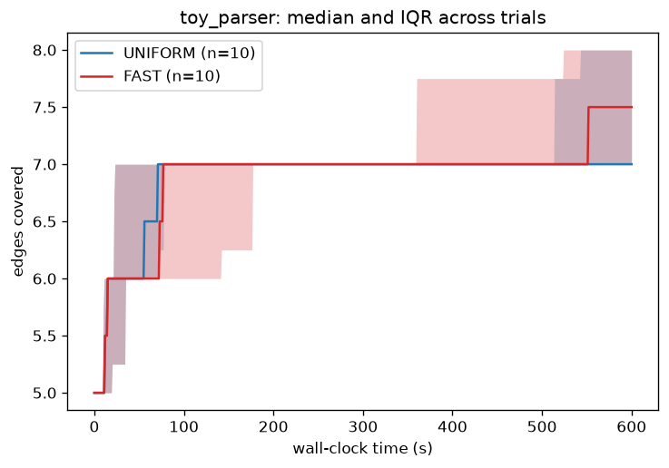
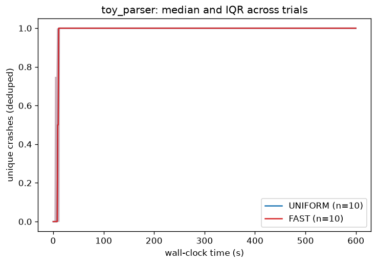
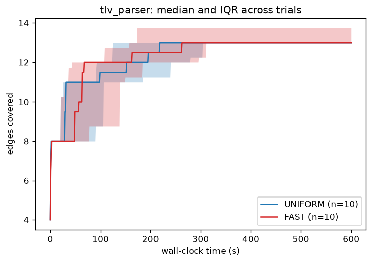
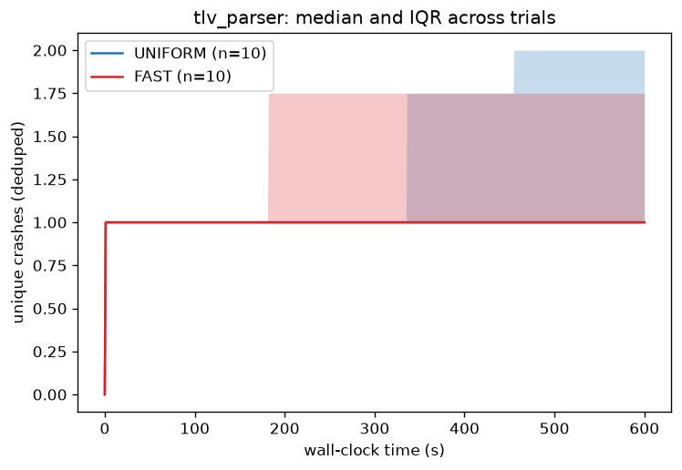
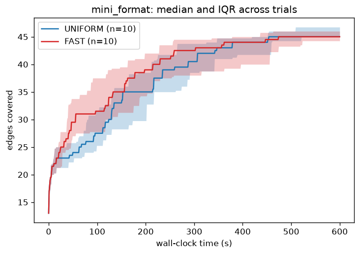
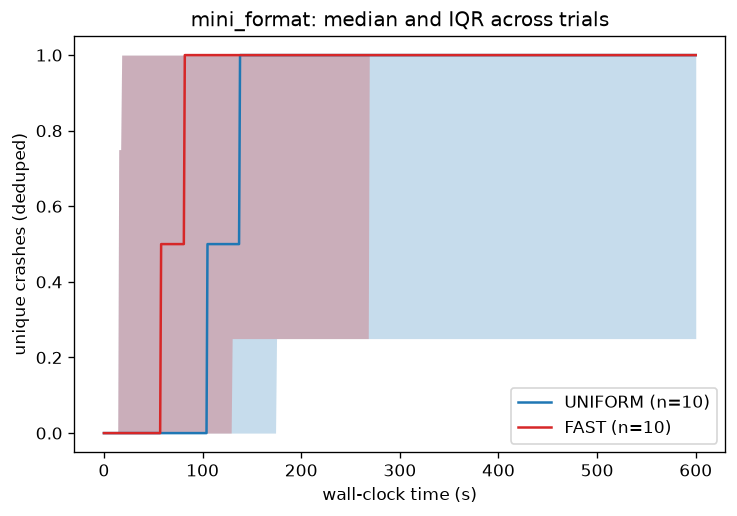

# Power Schedules in a Naive Greybox Fuzzer: A Small-Scale Reproduction of AFLFast under the Klees et al. Standard

## 1 Introduction

AFLFast (Böhme, Pham and Roychoudhury, CCS 2016) models coverage-based greybox
fuzzing as a Markov chain. It argues that a fuzzer should give more *energy*
(mutants per seed) to seeds that exercise rarely seen paths. Klees, Ruef,
Cooper, Wei and Hicks (CCS 2018) showed that many fuzzing evaluations do not
support their claims: they use too few trials, no significance tests, short
budgets, and crash counts inflated by poor de-duplication.

A prior report defined a fuzzer only at a surface level (PRD §1). This project
instead builds a small AFL-style greybox fuzzer from scratch in Python and C,
and tests one claim with it. It compares a uniform energy schedule (UNIFORM)
with AFLFast's exponential schedule (FAST), and it evaluates that comparison
the way Klees et al. require. The question is whether the *direction* of
AFLFast's power-schedule advantage reproduces at small scale. The absolute
numbers are not in question (PRD NG2).

The hypothesis, H1 (PRD §8), is:

> on at least one member of the primary family, FAST differs from UNIFORM at
> Holm-adjusted p < 0.05 (two-sided) in FAST's favour as A12 shows it: A12 > 0.5
> for final edges (more coverage), or A12 < 0.5 for a deep bug's
> time-to-first-crash (found earlier).

The planned scale, which is also the scale that ran, is:
- 3 targets × 2 schedules × 10 trials;
- 600 s per trial.

The configuration is in `experiments/configs/main.yaml` at the freeze commit,
and the run record is `results/main/campaign.json`.

Coverage feedback never steers a mutation here; mutation is blind. Coverage
decides only (a) which candidates are retained in the corpus and (b), through the
power schedule, how much energy each retained seed gets. The two arms differ only
in (b).

The code, reviews and tests were produced by AI coding agents (Claude Code
subagents) under a ticket workflow with enforced hooks, led from 2026-11-14 by
an AI assistant (Claude) to which the human delegated the lead role; the human
(the student) made the early scoping and design decisions, ran every commit and
push, and is responsible for the submission (§4.1).

**Verdict.** By the pre-registered rule (PRD §8), hypothesis H1 is **not supported**.
None of the six primary comparisons reaches Holm-adjusted p < 0.05: every
Holm-adjusted p is 1, and the smallest unadjusted primary p is 0.5129. The
experiment is a null result at this scale. Section 8 says what it does and
does not show.

### 1.1 What the project does: input and output

The fuzzer takes one instrumented C program and a starting input, mutates that
input blindly for a fixed time budget, and records what it reached and what
crashed. The campaign runner repeats this over targets, schedules and RNG seeds,
and the analysis turns the repeated trials into statistics and figures (§3,
§5.1).

**Input.**
- A C program built by `make -C targets` with clang (Homebrew LLVM on macOS) at `-O0`,
  with SanitizerCoverage `trace-pc-guard` and AddressSanitizer (Serebryany et al., 2012), and linked with
  the coverage runtime `targets/cov_rt.c` (ADR-0001, ADR-0002). The binary is
  `targets/bin/<target>`.
- Its starting seed S0, `targets/seeds/<target>/S0`, whose SHA-256 is in
  `targets/seeds/SHA256SUMS` (Appendix A).
- A configuration. One trial (`python -m fuzzer.cli`) takes the schedule
  (`uniform` or `fast`), the budget in seconds, the RNG seed, the execution
  timeout and an output directory. A campaign config
  (`experiments/configs/main.yaml`) lists the targets, the schedules, the
  trials per configuration, the seconds per trial, the base seed (trial *i*
  uses base seed + *i*), the timeout and the concurrency.

**Output per trial** (`results/main/<target>/<schedule>/s<seed>/`).
- The corpus: every retained input, in `queue/`.
- Crash inputs. Every crash is a row of `crash_events.csv`. An input whose
  path or crash site is new is also saved in `crashes/`, with its ASan report.
  `harness/dedup.py` buckets the crashes by the first in-target stack frame and
  maps each bucket to a planted bug through `targets/ground_truth.json`
  (ADR-0003).
- A coverage timeline: `metrics.csv`, with one row whenever the edge count, the
  corpus size or the crash count changes, and a final row (elapsed time,
  executions, edges, corpus size, crashes).
- `run.json`: the arguments, the commit, and the hashes of the seed files.

**Output per campaign** (`results/`).
- `results/main/campaign.json`, the run record (§5.2).
- From `harness/aggregate.py`: `trials.csv`, one row per trial, and
  `summary.csv` and `summary.md`, with per target and endpoint the medians and
  quartiles, the Mann-Whitney U test, the p-value, the Holm-adjusted p-value
  for the primary family, and A12 (§5.1).
- From `harness/plots.py`: per target, a coverage figure and a unique-crash
  figure, showing the median and inter-quartile band over time (§6.3).
- The H1 verdict. No code computes it: the pre-registered rule (PRD §8; this report's §5.1)
  is applied to the primary-family rows of `summary.csv`, and this report
  states the result (§6.1).

## 2 Background

In this section, section and figure numbers in parentheses refer to the paper being described.

### 2.1 AFLFast's claim

A greybox fuzzer runs a loop (AFLFast §2.1, Alg. 1):
1. Pick a seed from the corpus.
2. Mutate it blindly, energy-many times.
3. Run each mutant.
4. Keep a mutant only if it adds coverage.

In AFLFast's model (§3), each state is a path, and fuzzing a seed is a draw from
the transition probabilities out of that path's state. Most mutants of most seeds
land on a few "high-frequency" paths. A schedule that gives every seed the same
energy therefore spends most of its budget re-discovering those paths.

AFLFast's power schedules (§4.1) set a seed's energy from two counts:
- s(i), the number of times seed i has been chosen from the queue;
- f(i), the number of generated inputs that exercised path i.

The exponential schedule FAST (eq. 4) is p(i) = min(α(i)/β · 2^s(i)/f(i), M). It
gives little energy to seeds on frequent paths, and grows energy exponentially
for seeds on rare paths each time they are chosen. FR-5 states our
implementation of eq. 4, and §3 below describes it.

The paper reports large gains on GNU binutils:
- AFLFast exposes 6 CVEs up to 14 times faster than AFL (§1; the CVEs are
  listed in Table 1);
- on `nm`, it exposes the CVEs on average 7× faster than AFL (abstract; §5.2);
- the exponential schedule does best of the schedules compared (§5.3, Fig. 10).

AFLFast also changes the search strategy: which seed is fuzzed next (§4.2).
Fig. 11 (§5.4) separates the two changes. With no search strategy, the power
schedule alone gives a smaller gain. That matters here, because this project
reproduces the schedule only (this report's §5.3; PRD §8, the seed-selection
deviation).

As context only, AFLFast was followed by fuzzers such as AFLGo (Böhme et al.,
CCS 2017), which directs fuzzing towards chosen program locations; FairFuzz
(Lemieux and Sen, ASE 2018), which targets rarely exercised branches; MOpt (Lyu
et al., USENIX Security 2019), which schedules mutation operators; and AFL++
(Fioraldi et al., WOOT 2020), one tool that combines ideas from earlier fuzzing
research, among them power schedules ported from AFLFast and then modified
(AFL++ `docs/FAQ.md`) and a mutation scheduler inspired by MOpt (AFL++
`docs/features.md`). None of them is used in this project's method.

### 2.2 The Klees et al. standard

Klees et al. surveyed 32 fuzzing papers (Table 1) and set out how a fuzzing
claim should be tested. This project holds itself to the following points:

- **Repeated trials and a significance test** (§4). Fuzzing is random, and
  single runs vary widely (Fig. 2). Compare arms with the Mann-Whitney U test
  (following Arcuri and Briand) and report the A12 effect size.
- **Budget** (§6, "Timeouts"). Results can reverse with the time budget. In
  their Fig. 4 (`nm`, with sampled seeds), AFLFast leads AFL at 6 h and AFL
  leads at 24 h. They recommend timeouts of at least 24 hours, "or else
  justification for less" (§9), and looking at the performance curve over time.
- **Ground truth for bugs** (§7). Crash counts from coverage profiles or stack
  hashes over- or under-count real bugs (§7.2–7.3). Planted bugs with known
  triggers give ground truth (§7.1). Coverage is a secondary measure (§7.4).
- **Seeds** (§5). Results depend on the initial seed. Klees et al. recommend
  trying several seeds.

Their own experiments used 30 or more trials of 24 h each (§3). The paper does
not set a minimum trial count, and it gives no thresholds for the size of A12.

## 3 Design and implementation

The fuzzer is in `src/fuzzer/`, the targets in `targets/`, and the evaluation
layer in `harness/`.

The design rests on the mental model from §1:
- Mutation is blind (FR-4).
- Coverage decides only which candidates the corpus retains (FR-3) and, through
  the schedule, how much energy each retained seed gets (FR-5).
- The arms differ only in that energy.
- Each trial starts from `targets/seeds/<target>/S0`, which is identical in
  both arms.

**Coverage (`coverage.py`, `targets/cov_rt.c`; ADR-0001).**
- Targets are compiled with clang's SanitizerCoverage `trace-pc-guard`.
- A small runtime (`cov_rt.c`) keeps one 8-bit counter per edge in a shared-memory
  bitmap. The counter saturates at 255.
- The fuzzer maps each count into AFL's hit-count buckets (1, 2, 3, 4–7, 8–15,
  16–31, 32–127, 128+). A path's identity (`path_id`) is a BLAKE2b hash of its
  (edge, bucket) pairs.
- "Final edges" counts distinct edge ids.

**Executor (`executor.py`; ADR-0002, ADR-0005).**
- Each execution starts a new process with `subprocess.Popen`. There is no fork
  server.
- AddressSanitizer runs with `abort_on_error=1:detect_leaks=0:symbolize=1`.
- Each execution gets one outcome. A hang takes precedence over a crash, and a
  crash over a clean exit.
- The campaign timeout is 5.0 s.

**Corpus (`corpus.py`; ADR-0004).**
- A candidate is retained only if it adds a new (edge, bucket) pair.
- The corpus owns the schedule's inputs s(i) and f(i). It selects seeds in a
  fixed round-robin order in both arms.

**Mutator (`mutator.py`).**
- Six blind operators. Havoc stacks 2 to 128 of them (`1 << randint(1, 7)`).
- Splice is used with probability 0.1. Inputs are capped at 1024 bytes.
- There is no deterministic stage (AFL-005).
- The mutator takes an injected RNG and imports only the standard library.

**Schedule (`schedule.py`).** This is the only place the arms differ.
- UNIFORM gives every seed 256 executions.
- FAST follows AFLFast's implementation (afl-fuzz.c, based on AFL 2.51b) rather
  than the paper's eq. 4:
  - factor = 2^s / f(i) for s < 16, and 32 / next_pow2(f(i)) from s = 16,
    capped at 32 (MAX_FACTOR);
  - perf = min(100 · factor / β, 1600), with β = 1;
  - a perf of 0 becomes 16 executions while the queue holds at most 10 seeds,
    and 1 execution after that;
  - energy = 256 · perf / 100, so the cap is 4096.

**Main loop (`fuzzer.py`).**
- One RNG, `random.Random(seed)`, drives every random choice in a trial.
- The schedule setting is read once.

**Enforcing the isolation.** Tests check that the arms really differ only in the
schedule:
- `tests/test_fuzzer.py::test_single_rng_and_single_schedule_branch_and_blind_mutate`;
- schedule tests that forbid RNG or clock use, forbid reflection, forbid
  imports beyond the standard library and `corpus`, and check that a schedule
  leaves corpus state untouched;
- `tests/test_corpus.py::test_corpus_does_not_import_schedule`;
- mutator tests on imports, the sole randomness source, and the absence of a
  deterministic stage

(added under AFL-004, AFL-006, AFL-023 and AFL-026, as a set).

**Targets (`targets/`).** Three C parsers we wrote, each with planted bugs and a
fixed starting seed S0.
- Each target has a *shallow* bug: some single-byte change of S0 triggers it.
- Each target has a *deep* bug: no single-byte change of S0 triggers it, and it
  needs a chain of at least three coverage-adding inputs (PRD §8).
- `-O0` is pinned: at `-O1`, clang folded the toy branches together (ADR-0001).

| target | bug | depth | where | trigger |
|---|---|---|---|---|
| toy_parser | toy-1 | deep | `check()` | a "BUG" prefix stores through a null pointer; staircase `Baaa` → `BUaa` → `BUGa` |
| toy_parser | toy-2 | shallow | `scan()` | `!` as the first byte gives a heap over-read |
| tlv_parser | tlv-1 | shallow | `main` | a length of 65–128 for type 0x01 (65–255 for other types) copies into a 64-byte field |
| tlv_parser | tlv-2 | deep | `parse_ext` | an extension record whose table index is ≥ 4, reached by a chain of byte changes from S0 |
| mini_format | mfp-2 | shallow | `rec_data` | a record length of 5–8 copies into a 4-byte buffer |
| mini_format | mfp-1 | deep | `rec_get` | an off-by-one index (`idx == size`); needs version 2, a T record, then a G record with idx = n |

There are no divide-by-zero bugs, because arm64's `sdiv` does not trap (PRD §8,
AFL-030). A static check
(`tests/test_target_static_check.py::test_target_has_no_banned_form`) bans 21
forms that could add unplanned bugs.

**Evaluation layer (`harness/`).**
- `run_campaign.py` runs the trials and records metadata.
- `dedup.py` buckets crashes by the first in-target stack frame (ADR-0003). It
  has three sentinels: `no_stack`, `unsymbolized` and `no_target_frame`.
- `aggregate.py` computes the statistics (§5.1).
- `plots.py` draws the median and inter-quartile band over time.

## 4 Development process

### 4.1 How this work was done

The code, reviews and tests were produced by AI coding agents (Claude Code
subagents), each working in one of the roles listed in §4.2, on a ticket
workflow whose key rules are enforced by hooks (phase 2). This report's text was
written by the orchestrating Claude Code session from the agents' findings, and
an AI reviewer checked its claims against the repository records.

In this report, **the lead** is an AI assistant (Claude), called "the advisor"
in CLAUDE.md §7 and "the lead" elsewhere in the records; it is not the
crew-lead agent role in §4.2. On 2026-11-14 the human delegated the lead role to it
(phase 7); the decisions marked "(lead decision, date)" are its decisions.

**The student's role.** Each item names the record it rests on.

- **Chose the research question:** does AFLFast's power-schedule advantage hold
  up when it is measured to the Klees et al. standard? (PRD §1 and goals G3–G4,
  in the first commit `d258fd7`.)
- **Scoped the project:** reproduce the *direction* of AFLFast's effect, not its
  numbers, and fuzz only our own code, with no network (PRD G3, NG2, NG3).
- **Made the early core design decisions**, each marked "(human decision,
  date)" or "(human, date)" in the record:
  - FAST's energy specification, following AFLFast's code (AFL-006,
    2026-11-07; the architect agent checked it line by line against AFLFast's
    source; §5.3);
  - havoc-only mutation, with no ordered deterministic stage (AFL-005,
    2026-11-07);
  - censored time-to-first-crash (AFL-012, 2026-11-07);
  - one fixed starting input, S0, per program, the sole initial corpus in both
    arms (AFL-011, PRD §8), and two or more planted bugs per program (PRD §8),
    both 2026-11-07;
  - edge presence as the coverage granularity (ADR-0001; replaced by AFL
    hit-count buckets on 2026-11-15 by lead decision, AFL-034), the ASan
    configuration (ADR-0002) and the corpus–schedule contract (ADR-0004), all
    2026-11-07;
  - any terminating signal counts as a crash, with a hang taking precedence
    (AFL-018, PRD FR-2, 2026-11-07);
  - stdin-only input and the seed corpus (AFL-003, AFL-008, 2026-11-07);
  - the stopping rule and execution-index replay (ADR-0005, 2026-11-07 to
    2026-11-13);
  - the pre-registered statistics (PRD FR-9, 2026-11-12) and disjoint RNG seed
    sets (AFL-011);
  - running everything on one Mac under macOS (PRD §8, 2026-11-13);
  - crash-site de-duplication (AFL-013, 2026-11-07) and, for crashes with no
    stack, one shared `no_stack` bucket, option A (ADR-0003, AFL-030,
    2026-11-14);
  - the git-write policy: deny, not ask (AFL-015, 2026-11-13).
- **Designed the multi-agent workflow's roles and ticket process:** wrote the
  seven agent role files and the ticket template, all in the first commit
  (`d258fd7`), and directed the agents (the student's corrected statement,
  2026-11-20; AFL-039 Log, 2026-11-21 entry; the session logs show no agent
  creating these files). The
  project manual (`CLAUDE.md`) came in the first commit, both as a tracked file
  and, byte-identical, inside `orchestration-addon.zip`; the first hooks came
  only inside the zip. The zip's origin is not recorded. The commit and push
  rules were later enforced more strictly, mostly by his decisions (AFL-015: a
  git-policy hook, a commit-message git hook, and deny rules in
  `.claude/settings.json`).
- **Delegated the lead role** to the AI assistant on 2026-11-14 (CLAUDE.md §7,
  commit `624ba11`; phase 7), and from then on relayed between it and Claude
  Code: in the session logs, every lead message found reaches Claude Code as a
  prompt he pasted, never through a file, tool result or other session (a text
  search, so not exhaustive; AFL-039 Log).
- **Approved and ran every commit and push** (CLAUDE.md §7; AFL-024 Log; every
  commit's author). CLAUDE.md §7 also records that early commits reached origin
  without a manual push, through an editor or extension pushing on commit;
  AFL-015 later found no auto-push configured. He also ran the machine-level steps of the experiment: he turned the macOS
  crash reporters off on 2026-11-15 and back on on 2026-11-17 (AFL-011 Log).
- **Is responsible for the submission** (AFL-024).

### 4.2 Phases

The project ran from 2026-11-07, the first commit (`d258fd7`), to 2026-11-17
(UTC), in 55 commits before this report. Each change traces to a ticket in `tickets/`. Work went through
seven roles (`.claude/agents/`): vision, req-engineer, architect, developer,
reviewer, tester and crew-lead. The phases below are in order. Each gives what
was done and why.

1. **Scoping.**
   - What: The PRD (`docs/PRD.md`) fixed the goal. Reproduce the *direction* of
     AFLFast's power-schedule effect, not its absolute numbers (NG2). Fuzz only
     our own code, with no network (NG3).
   - Why: A prior report had described a fuzzer only at the surface (PRD §1).
     Goal G5 asks for a report rigorous enough to answer that critique.
2. **Guardrails.**
   - What: Hooks in `.claude/hooks/`:
     - `require_ticket_in_commit.py` rejects a commit message with no ticket id;
     - `gate_ticket_done.py` runs `ruff`, `mypy` and `pytest` on any move of a
       ticket into `done/`;
     - `git_policy.py` denies git write operations to agents, so the human runs
       every commit and push.

     A tracked `.githooks/commit-msg` repeats the ticket-id check. The three
     PreToolUse hooks and the commit-msg hook were tracked in `d787835`
     (AFL-015).
   - Why: An instruction to an agent is advisory; a hook is enforced.
3. **Spike.**
   - What: AFL-001 (`1322451`, 2026-11-07) checked that the instrumentation
     separates two inputs that take different branches. The two edge sets were
     A = {1, 2} and B = {1, 3}, and the result was GO.
   - Why: Everything else depends on the coverage signal. The spike also found
     that Apple clang 17's ASan hangs on macOS 26.5, so the build uses Homebrew
     LLVM (ADR-0001).
4. **Engine.**
   - What: The coverage, executor, corpus, mutator, schedule, main-loop and CLI
     modules (AFL-002 to AFL-008). `-O0` was pinned in AFL-002 (`20ffa34`).
     FAST's energy was checked against AFLFast's `afl-fuzz.c` in AFL-006
     (`fe73240`, `c7564de`). The deterministic stage was dropped in AFL-005
     (`0e1c784`).
   - Why: The arms must share everything except the schedule, and FAST must
     match the code the paper's results came from.
5. **Pre-registration.**
   - What: The hypothesis, endpoints, tests and decision rules were committed
     before any pilot ran. In order:
     - the retuning rule (`1a862b3`);
     - the corpus–schedule contract and S0 (`f355169`);
     - the statistics (`1356e97`);
     - the freeze rules, timing probe and stopping rule (`8894189`, ADR-0005);
     - the endpoint cutoff (`f444b63`);
     - the provisional timeout (`5ae9dbd`), whose final value was fixed under
       PRD §8 (h) at the freeze;
     - the concurrency revision driven by the probe (`dc54baf`);
     - the last pre-pilot commit (`d9a22db`).

     The first pilot ran at 2026-11-16T00:31:33Z, after all of these. Only the
     commit order can be checked; the push time is recorded only for the freeze
     commit.
   - Why: Klees et al.'s concern is analysis chosen after seeing the data.
     Writing the rules first removes that choice.
6. **Targets.**
   - What: Three targets with S0 seeds (toy `2fc1381`, tlv `5aced24`, mini
     `8317301`). Slow single-byte sweeps (`test_single_byte_sweep`) check that
     each shallow bug has a single-byte trigger and each deep bug has none. The
     static check bans unplanned bug forms (AFL-030).
   - Why: Planted bugs with known triggers are the ground truth Klees et al.
     ask for (their §7.1). The depth definitions let the deep bugs test AFLFast's
     rare-path argument.
7. **Delegation.**
   - What: On 2026-11-14 the human delegated the lead role to the AI assistant
     (the lead, §4.1). The human runs commits and pushes and approves them on
     the lead's review (CLAUDE.md §7, recorded in `624ba11`).
   - Why: The human had to move to another project; delegation kept decisions
     moving while the human kept every commit and push at fixed stops. The
     record marks each lead decision "(lead decision, date)".
8. **Timing probe.**
   - What: The probe measured throughput and set the concurrency and timeout.
     - With macOS's per-user crash reporter on, ReportCrash used up to about 80% of a
       core during tlv trials, which crash about 3,300 times each.
     - The per-user agent and then the system daemon were turned off. A
       functional test then gave 50 tlv-1 crashes with no ReportCrash process.
     - The first probe runs, made with the per-user reporter on, are
       superseded and not used for the concurrency decision; the official
       run's D_max (0.280 s) still counts towards the timeout floor (PRD §8).
     - With both reporters off, the slowdown at concurrency 5 was nearly
       unchanged: 58–77% of the baseline with the per-user reporter on, 52–74%
       with both off. The slowdown is therefore attributed to running trials in
       parallel, which share CPU, memory bandwidth and process creation on a
       machine with 4 performance and 6 efficiency cores (PRD §8), not to the
       reporters; it was not profiled.
     - Baseline at concurrency 1 (uniform/fast, exec/s): toy 18.8/18.9,
       tlv 14.4/14.4, mini 13.2/13.3.
     - At concurrency 5, the targets reached 51.7%, 56.8% and 74.0% of the
       baseline, below the 80% rule, so concurrency went to 3.
     - At 3, official run 1 gave 77.5%, 98.4% and 108.3%. Toy stayed below 80%;
       this is disclosed in deviation (vii).
     - D_max is the slowest crash duration of any planted bug's known trigger
       (PRD §8). It was at most 0.345 s across the probe runs. The timeout floor
       is 3 × D_max ≈ 1.04 s, and the frozen timeout is 5.0 s.
   - Why: The reporters cost CPU on every crash. The PRD records that this
     "slows the trials and so would bias the item (d) comparison" (PRD §8).
     By default, AFL also refuses to fuzz on macOS while crash reporting is
     on. In AFL's `afl-fuzz.c` (as kept in AFLFast), `check_crash_handling()`
     (macOS branch) checks `launchctl list` for the per-user
     `com.apple.ReportCrash` agent; its pattern cannot match the `.Root`
     daemon. If the agent is loaded, it aborts with "Crash reporter detected"
     unless `AFL_I_DONT_CARE_ABOUT_MISSING_CRASHES` is set. AFL's stated reason
     differs from the PRD's: the reporter delays the crash signal, so crashes
     can be misread as timeouts. The fix it prints unloads both the per-user
     agent and the `.Root` system daemon (legacy `launchctl unload -w`), the
     same two services this project turned off empirically with `disable` and
     `bootout`. AFL++'s `docs/INSTALL.md` (macOS section) also says the
     default crash reporting daemon causes problems with fuzzing and must be
     turned off (it points to `afl-system-config`). The lead gave one further
     reason: the reporters could penalise the arm that crashes more.
9. **First pilot.**
   - What: Three trials per arm on `d9a22db`, seeds 2000–2002.
     - The granularity trigger fired for toy and tlv, but not mini. The whole
       experiment therefore switched from edge sets to hit-count buckets
       (AFL-034).
     - The find rule fired for tlv-2 and mfp-1: neither arm found either bug.
       Both were retuned once, with new S0 seeds, in AFL-035 (`30d7e98`).
     - toy-1 was found once (fast, 569.2 s) and was not retuned.
     - The pre-registered toy-1 calibration prediction (AFL-011 item (g),
       recorded 2026-11-12 before any pilot: found in some trials but not all,
       in each arm) held for FAST (1/3) and missed for UNIFORM (0/3). It is
       reported as a miss.
   - Why: The pre-registered rules exist to catch a target that cannot
     discriminate, before the campaign spends its budget on it.
10. **Confirmation pilot.**
    - What: Three trials per arm on `30d7e98`, seeds 4000–4002.
      - toy-1 was found 1/3 (uniform, 449.0 s) vs 0/3.
      - tlv-2 was found 0/3 vs 2/3 (fast, 191.2 s and 282.8 s).
      - mfp-1 was found 0/3 in both arms.
      - Every shallow bug was found in every trial.
    - The rule allows no second retune, so mfp-1 went into the campaign as it
      was.
    - Seeds 5000–5002 and 6000–6002 were reserved for restarted pilots. They
      were not used (`seed_sets` in campaign.json).
    - Why: The confirmation pilot checks the retune without using campaign
      seeds. Its lesson is in §7 (calibration).
11. **Freeze.**
    - What: Official run 2 ran on the candidate freeze commit `1aa932f`; the
      freeze commit `ff19bef7abb57b1ccbffd0318e2bbcb3c13f9cfc`, pushed at
      2026-11-16T18:52:14Z, has identical code. Run 2 differed from run 1 by
      less than the 0.20 limit on every measure. `pytest -m slow` passed
      (10 tests).

      There was one slip. `1679c36` was committed and pushed as the freeze
      before the lead's ruling on deviation (vii) had been applied. It was
      fixed forward: `ff19bef` applies the ruling.
    - Why: After the freeze, the analysis and code are fixed, and later changes
      can be compared against it.
12. **Campaign.**
    - What: 60 trials (3 targets × 2 arms × 10 seeds), 2026-11-16T19:06:36Z to
      22:26:41Z, all on the freeze commit with a clean tree.
      - Every trial exited 0 and counted. There were no aborts, no flagged
        trials and no re-runs.
      - The crash reporters were off at the start and at the end.
      - The load average was 2.13 at the start and 4.68 at the end.
    - Why: This is the pre-registered experiment.
13. **Analysis.**
    - What: AFL-033 added input guards before the analysis ran. The analysis
      refuses a campaign with no finish time or a trial cut short; AFL-012's
      tester had shown that the analysis still accepted truncated trials
      (rc 0). The analysis
      ran once, at 2026-11-17T00:50:55Z, with the hashes recorded in
      `docs/report/PROVENANCE.md`.
    - Why: The analysis must not silently accept a damaged trial, and running
      it once avoids choosing among runs.
14. **Wrap-up.**
    - What: `ee0ac4b` committed the analysis code, the results snapshot in
      `docs/report/` and `data/SHA256SUMS`. The raw-results archive is kept off
      the repository; the lead's stated reason is that it contains home-directory
      paths. The crash reporters were turned back on at 2026-11-17T01:53:48Z.
      AFL-011 then closed through the gated move. Its first attempt failed one
      trigger test (a hang instead of a crash); this is attributed to the
      reporters, not measured, and AFL-038 raises that test's timeout.
    - Why: The record must let a reader check the data without trusting the
      authors.

### 4.3 Technical challenges

| Challenge | What was done | Overcome? | Where recorded |
|---|---|---|---|
| Apple clang's ASan hung at start-up on macOS 26.5 (in `FindDynamicShadowStart`). | Required Homebrew LLVM clang on macOS (on Linux the Makefile falls back to `clang` on PATH). | Worked around: the toolchain is a stated prerequisite. | ADR-0001 "Toolchain"; AFL-001 Log 2026-11-07; §4.2 phase 3 |
| At `-O1` the compiler folded branches, so inputs taking different paths gave the same edge set. | Pinned `-O0` in the Makefile's required flags, which `CFLAGS` cannot override (the AFL-002 tester found that `CFLAGS=-O2 make` had dropped them). `tests/test_coverage.py` checks that the paths give distinct edge sets. | Yes. | ADR-0001 follow-up owned by AFL-002; AFL-002 Log 2026-11-07 |
| Edge presence was too coarse. The pre-registered granularity rule fired on the first pilot (median distinct paths below 20 on toy_parser and tlv_parser). | Switched both arms to AFL's hit-count buckets before the freeze, as the rule required. | Yes, by the pre-registered rule. | ADR-0001 Amendment 2026-11-15; AFL-034; AFL-011 Log 2026-11-15; §4.2 phase 9; §7 |
| The macOS crash reporter used up to about 80 % of a core while tlv_parser crashed about 3,300 times per trial, slowing the trials. | Turned off the per-user agent, then the system daemon. A functional test (crashes produced no reports) checked this. Both were turned back on after the campaign (2026-11-17T01:53:48Z). | Yes for the campaign. The README states the off and on commands. | PRD §8 "Crash reporters"; AFL-011 Log 2026-11-15 and 2026-11-17; §4.2 phase 8; §7 |
| Running trials in parallel slowed each trial. At concurrency 5, every target ran below 80 % of the concurrency-1 rate (toy_parser 51.7 %, tlv_parser 56.8 %, mini_format 74.0 %). | Lowered concurrency to 3, the one revision the pre-registered rule allowed. | Partly. At 3, toy_parser was still at 77.5 % (tlv_parser 98.4 %, mini_format 108.3 %); this is disclosed. The cause was not profiled. | AFL-011 Log 2026-11-15; PRD §8 (vii); commit `dc54baf`; §7 |
| A crash whose ASan report ran past the timeout was recorded as a hang and lost as a crash (under load at a 1 s timeout, one test failed 129 of 600 runs). | Set the timeout from measured crash durations (`timeout_s` ≥ k × D_max with k = 3, a floor of 3 × 0.345 s ≈ 1.04 s); the campaign used 5.0 s. | Yes; no hangs in the official runs. | ADR-0005 §4; AFL-011 Log 2026-11-13 and 2026-11-15 |
| With the reporters back on, one trigger test recorded a hang instead of a crash. | Raised the trigger tests' timeout from 1.0 s to the campaign's 5.0 s; no assertion changed. | Yes. The cause is attributed to the reporters, not measured. | AFL-038 Log 2026-11-17; AFL-011 Log 2026-11-17; §4.2 phase 14 |
| Throughput was about 14 exec/s per trial against NFR-3's 500 exec/s target. | Documented as NFR-3 asks. No fork server was built; AFL-003 made one conditional on AFL-011's numbers. | No. The campaign ran about 35× below the target. A new process per execution plus ASan start-up is the attributed cause, not profiled. | PRD §7 NFR-3; AFL-003 Log 2026-11-07; §6.4; §7 |
| The mfp-1 retune targeted a total difficulty without allowing for round-robin splitting each trial's executions across all seeds (about 230 per seed on mini_format). | Recorded as a lesson. The pre-registration allowed only one retune. | No. mfp-1 was found in 0 of 10 trials in each arm. | AFL-011 Log 2026-11-16; AFL-035; §4.2 phase 10; §7 "Calibration" |
| A crash with no ASan stack is put in one `no_stack` bucket whatever its signal. | Disclosed the bias (AFL-030 option A). A static check keeps such crash sources out of the planted targets. | Yes, within the planted targets. | ADR-0003 (AFL-030 section); AFL-030 |

### 4.4 Alternative designs explored

This section lists 19 design decisions for which a record shows an alternative
was considered. The list is not exhaustive: the ADRs and ticket Logs record
smaller ones. Each item gives the decision, the alternatives, the choice, the
reason and the record.

1. **Compiler.**
   - Alternatives: Apple clang; Homebrew LLVM clang.
   - Choice: Homebrew LLVM.
   - Reason: Apple clang's ASan hangs at start-up on macOS 26.5.
   - Record: ADR-0001 "Toolchain"; AFL-001.
2. **Optimisation level.**
   - Alternatives: `-O1`; `-O0`.
   - Choice: `-O0`, pinned.
   - Reason: `-O1` folded branches, so distinct paths gave the same edges.
   - Record: ADR-0001 follow-up; AFL-002.
3. **Coverage mechanism.**
   - Alternatives: SanitizerCoverage `trace-pc-guard` with a shared-memory bitmap; `gcov`; a file-based guard callback.
   - Choice: `trace-pc-guard` with shared memory.
   - Reason: fast and faithful to AFL; the others do I/O on every run.
   - Record: ADR-0001 "Options considered".
4. **Coverage granularity.**
   - Alternatives: edge presence; AFL hit-count buckets.
   - Choice: presence first (human decision, 2026-11-07), then buckets.
   - Reason: the pre-registered granularity rule fired on the first pilot.
   - Record: ADR-0001 Amendment 2026-11-15; AFL-034.
5. **`ASAN_OPTIONS`.**
   - Alternatives: leave ASan's defaults and widen FR-2's crash definition; append the required options to the inherited value; replace it with one fixed string.
   - Choice: replace.
   - Reason: inherited options would make results depend on the operator's shell.
   - Record: ADR-0002 "Options considered".
6. **Crash de-duplication key.**
   - Alternatives: faulting PC; a hash of the top N frames; the first in-target stack frame.
   - Choice: the first in-target frame.
   - Reason: the PC varies with ASLR and build, and a top-N hash overcounts one bug reached by several stacks.
   - Record: ADR-0003 "Options considered".
7. **Stackless crashes.**
   - Alternatives: option A, one `no_stack` bucket with the bias disclosed; option B, the signal name in the sentinel.
   - Choice: option A (human decision, 2026-11-14).
   - Reason: no planted target can raise a stackless crash, and a static check enforces this.
   - Record: ADR-0003; AFL-030.
8. **FAST energy.**
   - Alternatives: the paper's eq. 4 as written; AFLFast's `afl-fuzz.c` code.
   - Choice: the code.
   - Reason: the energy spec was decided by the human and checked line by line against AFLFast's source (AFL-006). It follows the code where the paper's text differs: β = 1 against the paper's β > 1 (PRD §8 (v)), and the s(i) ≥ 16 branch (PRD §8 (viii)).
   - Record: ADR-0004 amendment 2026-11-07; PRD §8 (v), (viii); AFL-006.
9. **UNIFORM baseline.**
   - Alternatives: AFLFast's EXPLORE (constant factor 1, energy 256); AFLFast's EXPLOIT ("AFL") schedule, which saturates at 4,096.
   - Choice: EXPLORE.
   - Reason: the record states the equivalence and the difference, not a separate reason.
   - Record: PRD §8 (iii); AFL-006.
10. **A FAST seed whose factor rounds to zero, above 10 seeds.**
    - Alternatives: skip it, as AFLFast does; give it 1 execution.
    - Choice: 1 execution.
    - Reason: every schedule returns energy ≥ 1 (ADR-0004 §8).
    - Record: AFL-006; PRD §8 (iv).
11. **Deterministic stage.**
    - Alternatives: AFL's ordered deterministic stages before havoc; havoc only.
    - Choice: havoc only, in both arms (human decision, 2026-11-07).
    - Reason: the deterministic stage spends a budget independent of the schedule, which would dilute the one variable measured.
    - Record: AFL-005.
12. **Seed selection.**
    - Alternatives: AFLFast's search strategies; round-robin (AFLFast's "No Strategy", its Fig. 11).
    - Choice: round-robin.
    - Reason: the project reproduces the power schedule in isolation.
    - Record: ADR-0004 §4–5; §5.3.
13. **Executor.**
    - Alternatives: a fork server; a new process per execution, with trials in parallel.
    - Choice: a new process per execution.
    - Reason: AFL-003 left a fork server conditional, to be decided at AFL-011. The lead's stated rule for AFL-011 item (d) chose parallel trials without one (lead decision, 2026-11-14).
    - Record: AFL-003; AFL-011 item (d), Log 2026-11-14.
14. **Concurrency.**
    - Alternatives: 5 trials at once; 3.
    - Choice: 3.
    - Reason: at 5, every target fell below the pre-registered 80 % rule.
    - Record: AFL-011 Log 2026-11-15; commit `dc54baf`; PRD §8 (vii).
15. **Stopping rule.**
    - Alternatives: wall-clock only; execution count only; both, whichever comes first.
    - Choice: both.
    - Reason: the wall-clock budget is the PRD's; the execution cap makes tests deterministic.
    - Record: ADR-0005 "Options considered".
16. **Reproducibility.**
    - Alternatives: full replay including timing; replay on the execution index.
    - Choice: the execution index.
    - Reason: timing depends on the machine.
    - Record: ADR-0005 "Options considered".
17. **Slow crash reports.**
    - Alternatives: a timeout set from measured crash durations; ASan `symbolize=0` with offline symbolisation.
    - Choice: the timeout; `symbolize=0` was not adopted (human decision, 2026-11-13).
    - Reason: `symbolize=0` would change how the crash site is computed.
    - Record: AFL-011 (timeout checklist item (h)); ADR-0005 §4.
18. **Censored time-to-first-crash.**
    - Alternatives: drop censored trials; clamp them to the budget; treat them as right-censored, ranked above every observed value.
    - Choice: right-censored (human decision, 2026-11-07). This is equivalent to Gehan's test.
    - Reason: dropping biases the result toward the arm that finds the bug less often, and clamping reports an unobserved time as observed.
    - Record: AFL-012; §5.1.
19. **Retuning tlv-2 and mfp-1.**
    - Alternatives: change the comparisons in the targets (the wording of AFL-035's goal); move S0 next to the unchanged comparisons.
    - Choice: move S0.
    - Reason: not stated beyond the method. S0 gained a dormant record, so every step is one substituted byte and no comparison changed. The lead's constraints (function, bug class, crash site, shallow bugs and `ground_truth.json` unchanged) held; tlv_parser gained one line, a distinct edge on the crashing side.
    - Record: AFL-035 Log 2026-11-15 (phase 1).

### 4.5 Code size

| Part | Files | Lines | Non-blank lines |
|---|---:|---:|---:|
| Fuzzer, `src/fuzzer/*.py` | 8 | 755 | 632 |
| Harness, `harness/*.py` | 4 | 1,525 | 1,320 |
| Targets, `targets/*.c` | 5 | 327 | 305 |
| `targets/Makefile` | 1 | 27 | 21 |
| Tests, `tests/*.py` | 21 | 5,231 | 4,175 |
| Hooks, `.claude/hooks/*.py` | 3 | 113 | 105 |
| Git hook, `.githooks/commit-msg` | 1 | 9 | 9 |
| **Total** | **43** | **7,987** | **6,567** |

The counts cover the files tracked at `a23c569`. "Lines" is `wc -l`, which
counts comments, docstrings and blank lines. "Non-blank lines" counts lines with
at least one non-space character (`grep -c '[^[:space:]]'`). The targets
include the AFL-001 spike (`spike.c`) and the coverage runtime (`cov_rt.c`).
The command, run from the repository root:

```sh
git ls-files | awk '/^src\/fuzzer\/.*\.py$/{c="src/fuzzer py"} /^harness\/.*\.py$/{c="harness py"} /^targets\/[^\/]*\.[ch]$/{c="targets C"} /^targets\/Makefile$/{c="targets Makefile"} /^tests\/.*\.py$/{c="tests py"} /^\.claude\/hooks\/.*\.py$/{c="hooks py"} /^\.githooks\/[^\/]+$/{c="githooks sh"} c{print c "\t" $0} {c=""}' | while IFS="$(printf '\t')" read -r c f; do printf '%s\t%s\t%s\n' "$c" "$(wc -l <"$f")" "$(grep -c '[^[:space:]]' "$f")"; done | awk -F'\t' '{p[$1]+=$2;n[$1]+=$3;f[$1]++} END{for(k in p)printf "%-18s files=%-3d physical=%-6d nonblank=%d\n",k,f[k],p[k],n[k]}' | sort
```

This code was produced by AI coding agents under the student's direction
(§4.1), except for two groups of lines whose origin is not recorded and which
the student did not write. First,
two hooks came in the first commit inside `orchestration-addon.zip`:
`.claude/hooks/require_ticket_in_commit.py` (18 lines; the tracked file is
byte-identical to the zip's copy) and `.claude/hooks/gate_ticket_done.py` (35
lines in the zip; agents later edited it to 39 lines). Second, `git blame` attributes 81 counted lines
(61 non-blank) in 15 files to the first commit: the starting versions of
`targets/toy_parser.c` (21 lines), `targets/tlv_parser.c` (16) and
`targets/Makefile` (14), and 30 lines of module stubs in `src/fuzzer/` and
`harness/`, including all of `src/fuzzer/__init__.py` (2 lines). To count a
file's lines from the first commit:
`git blame --root a23c569 -- <file> | grep -cE '^\^?d258fd7'`. The session
logs show no tool call writing anything before that commit. The student wrote
none of the counted code lines: he did not write the two groups above (his
statements, 2026-11-20 and 2026-11-21, AFL-039 Log), and agents wrote the
rest. He wrote only the first versions of the seven role files and the ticket
template; those no agent later edited are counted below. His part is
described in §4.1.

| Workflow files written by the student | Files | Lines | Non-blank lines |
|---|---:|---:|---:|
| Role files `.claude/agents/{architect,crew-lead,developer,req-engineer,reviewer,vision}.md` and `tickets/templates/ticket-template.md` | 7 | 301 | 241 |

The Claude Code session logs, whose first prompt is at 2026-11-07T14:36Z,
22 minutes before the first commit (the earlier records, from 11:33Z, are
local commands only: `/login`, `/exit`, `/agents` and `/list-agents`), show no tool
call that created or edited these seven files, and none has changed since the first commit (`d258fd7`)
(AFL-039 Log). `.claude/agents/tester.md` was also his originally; agents
edited it later, so it is not counted. `CLAUDE.md` came in the first commit
(also inside the zip) and is not his. The counts use the same two measures as above:

```sh
cat .claude/agents/{architect,crew-lead,developer,req-engineer,reviewer,vision}.md tickets/templates/ticket-template.md | wc -l
cat .claude/agents/{architect,crew-lead,developer,req-engineer,reviewer,vision}.md tickets/templates/ticket-template.md | grep -c '[^[:space:]]'
```

## 5 Method

### 5.1 Pre-registered analysis

The hypothesis and analysis were fixed in PRD §8 before any pilot (§4, phase 5).
H1, verbatim:

> on at least one member of the primary family, FAST differs from UNIFORM at
> Holm-adjusted p < 0.05 (two-sided) in FAST's favour as A12 shows it: A12 > 0.5
> for final edges (more coverage), or A12 < 0.5 for a deep bug's
> time-to-first-crash (found earlier).

H1 is **not supported** if no primary member reaches Holm-adjusted p < 0.05. It
is **mixed** if significant members point both ways. Exploratory comparisons
neither support nor refute H1.

**Endpoints.**
- The **primary family** has six members:
  - final edges for each of the three targets;
  - time-to-first-crash (TTFC) for each deep bug (toy-1, tlv-2, mfp-1).
- **Exploratory** endpoints (nine): edge-coverage area, unique crashes, and TTFC
  for each shallow bug.
- All endpoints are read at the 600 s budget. An execution that overruns the
  budget counts toward none.

**Tests, as implemented in `harness/aggregate.py`.**
- Two-sided Mann-Whitney U, asymptotic with continuity correction, at α = 0.05.
- Censored TTFC: a trial that never finds a bug is set to infinity, so it ties
  above every observed time. Censored trials are never dropped and never
  clamped. AFL-012's Log records this as equivalent to Gehan's generalized
  Wilcoxon test.
- Effect size: A12 = A12(FAST, UNIFORM). A value above 0.5 means FAST's values
  tend to be larger, which is better for edges and worse for TTFC.
- Holm-Bonferroni over the fixed primary family of six. Exploratory p-values are
  uncorrected and labelled as such.
- Edge-coverage area is the area under the step function of edges over [0, 600] s.
- Quartiles use linear interpolation. A quantile that falls among censored
  trials is reported as "> budget", or as a lower bound when it cannot be fixed.

**Effect-size labels.** We label A12 using Vargha and Delaney (2000):
|A12 − 0.5| < 0.06 negligible, < 0.14 small, < 0.21 medium, otherwise large. These
labels are **not pre-registered**. They are an interpretation aid added after the
analysis (lead decision, 2026-11-17), and they never change which rows are
significant. We found no thresholds in Klees et al.

**Retuning and granularity rules.** These were pre-registered in AFL-011 and
applied only to the first pilot.
- **Retune rule.** A deep bug's target could be retuned with a new S0 if:
  - (i) neither arm found it in any first-pilot trial; or
  - (ii) both arms found it in every first-pilot trial within the first 5% of
    the budget.

  A target could be retuned at most once.
- **Granularity rule.** The coverage signal would switch to hit-count buckets
  if, on any target, the median number of distinct path ids was below
  2 × the median corpus size, or below 20.

First-pilot values (`results/pilot`):

| target | median distinct path ids | median corpus size | granularity rule fired |
|---|---|---|---|
| toy_parser | 4.5 | 3.5 | yes |
| tlv_parser | 14.0 | 8.0 | yes |
| mini_format | 65.5 | 20.0 | no |

The rule fired on two targets, so the whole experiment moved to hit-count
buckets (AFL-034).

### 5.2 Campaign procedure

- **Config** (`experiments/configs/main.yaml`, frozen at `ff19bef`):
  - 3 targets × 2 schedules × 10 trials, 600 s per trial;
  - seeds 1000–1009 (trial i uses 1000 + i), the same in both arms;
  - timeout 5.0 s, three trials at a time.
- **Seed separation:** the seed sets are pairwise disjoint: campaign
  1000–1009, first pilot 2000–2002, confirmation pilot 4000–4002.
- **Starting seeds:** each target starts from a single fixed S0. The SHA-256
  values are in `targets/seeds/SHA256SUMS` and Appendix A.
- **Freeze:** every trial ran on the freeze commit
  `ff19bef7abb57b1ccbffd0318e2bbcb3c13f9cfc`.
- **De-duplication:**
  - A crash is bucketed by its first in-target stack frame (ADR-0003). Crashes
    with no usable frame go to a sentinel bucket.
  - Buckets map to planted bugs through `targets/ground_truth.json`. A bucket
    whose function matches no planted bug is the unknown bucket.
  - The method has two known biases. One bug can produce many stacks, which
    over-counts. Two bugs can share a function, which under-counts.
  - A planted bug's TTFC is the time of the first crash in its bucket.
- **Machine** (from `results/main/campaign.json`; the Python version is from
  each trial's `run.json`):
  - Apple Mac16,1 with 10 physical cores (4 performance, 6 efficiency);
  - macOS 26.5, Homebrew clang 23.1.3, Python 3.12.9;
  - both macOS crash reporters off;
  - no sleep during the campaign.

### 5.3 Deviations from AFLFast

The PRD (§8) lists ten deviations from AFLFast. Those that concern the schedule
were checked against AFLFast's `afl-fuzz.c`, which is based on AFL 2.51b.
AFLFast's paper says it extends AFL 1.94b (its §4.3).

| # | deviation | AFLFast | here | effect on the comparison |
|---|---|---|---|---|
| PRD §8, seed-selection deviation | search strategy | prefers seeds on rare paths, culls favoured seeds, skip probabilities (AFLFast §4.2) | fixed round-robin in both arms, no culling or skipping | results bear on the power schedule alone; UNIFORM is not vanilla AFL's queue; Fig. 11 shows a smaller gain without the strategy |
| PRD §8, deterministic-stage deviation | deterministic mutations | deferred in AFLFast (its §4.3) | dropped in both arms (AFL-005) | both arms go straight to havoc |
| PRD §8 (i) | f(i) | `n_fuzz` counts every execution, including crashes and hangs (afl-fuzz.c:3144) | counts clean executions only | a crashing run normally has a truncated path that matches no seed (ADR-0004 §2); only where one shares a seed's path_id is that seed's f(i) lower than AFLFast's, giving it slightly more energy; the same rule applies in both arms |
| PRD §8 (ii) | α(i) | AFL's performance-score adjustments | dropped; α ≡ 256 | energy depends only on s(i) and f(i) |
| PRD §8 (iii) | baseline | AFLFast's EXPLOIT ("AFL") schedule sets the factor to MAX_FACTOR, which saturates at 4096 | UNIFORM = EXPLORE, factor 1 | the baseline is a constant 256 executions |
| PRD §8 (iv) | zero factor and hit counts | when perf is 0: HAVOC_MIN (16) executions while queued_paths ≤ 10; above 10, the seed is skipped | 16 while ≤ 10 seeds; energy 1 above 10 instead of skipping; hit-count buckets 1, 2, 3, 4–7, 8–15, 16–31, 32–127, 128+; retention, path_id and f(i) over (edge, bucket) pairs; 8-bit counter saturates at 255 where AFL 2.x wraps; final edges = distinct edge ids | first-pilot path ids and corpus sizes are not comparable with later ones; edge counts are unaffected |
| PRD §8 (v) | β | the paper says β > 1 | β = 1, as in AFLFast's config.h:92 | follows the code, not the paper |
| PRD §8 (vi) | havoc doubling | energy doubles when havoc finds a new path | omitted; 4096 is a hard cap | FAST cannot exceed 4096 executions per selection |
| PRD §8 (vii) | havoc_div | divides energy on slow targets | dropped; throughput was 14.1/13.2/13.6 exec/s at concurrency 3 (freeze official run 2) | attributed to executor overhead (a new process per run plus ASan start-up), not profiled separately; under a fork server these parsers would almost certainly fall in the fast band, where havoc_div = 1 (PRD §8 (vii)); speed with a fork server not measured; toy_parser at concurrency 3 reached 77.5% of its single-trial rate, disclosed here |
| PRD §8 (viii) | factor for s ≥ 16 | 32/next_pow2(f(i)) (afl-fuzz.c:4803–4806) | the same | not a deviation from AFLFast; a deviation from the paper's eq. 4 |

## 6 Results

All numbers are from `docs/report/summary.csv`. These files are byte-identical
copies of the analysis outputs (see `docs/report/PROVENANCE.md`). Each arm has
n = 10. All 60 trials were valid, with no hangs and no sentinel crashes.

### 6.1 Primary family (Holm-Bonferroni, m = 6)

| target | endpoint | n (U/F) | UNIFORM median [Q1, Q3] | FAST median [Q1, Q3] | find rate U / F | U | p | Holm p | A12 | label (not pre-registered) |
|---|---|---|---|---|---|---|---|---|---|---|
| toy_parser | final edges | 10/10 | 7 [7, 8] | 7.5 [7, 8] | — | 55 | 0.6934 | 1 | 0.55 | negligible |
| tlv_parser | final edges | 10/10 | 13 [13, 13] | 13 [13, 13.75] | — | 57.5 | 0.5129 | 1 | 0.575 | small |
| mini_format | final edges | 10/10 | 45 [45, 46.75] | 45 [44.25, 46] | — | 45 | 0.7265 | 1 | 0.45 | negligible |
| toy_parser | TTFC toy-1 (deep) | 10/10 | > budget | > budget | 1/10 / 1/10 | 49.5 | 1 | 1 | 0.495 | negligible |
| tlv_parser | TTFC tlv-2 (deep) | 10/10 | > budget [365.3, > budget] | > budget [≥ 181.2 not determinable, > budget] | 4/10 / 3/10 | 52 | 0.8942 | 1 | 0.52 | negligible |
| mini_format | TTFC mfp-1 (deep) | 10/10 | > budget | > budget | 0/10 / 0/10 | 50 | 1 | 1 | 0.5 | negligible |

No primary comparison is significant. By the pre-registered rule (PRD §8), hypothesis H1 is **not supported**.

The deep bugs were rarely found:
- toy-1 was found 1/10 in each arm: uniform at 528.68 s (seed 1006), fast at
  134.0 s (seed 1005).
- tlv-2 was found four times under UNIFORM (94.17, 307.79, 335.45 and
  454.85 s) and three times under FAST (167.37, 177.15 and 181.2 s).
- mfp-1 was never found.

In every deep-bug row both medians lie beyond the budget. The TTFC tests
therefore compare mostly tied, censored trials.

### 6.2 Exploratory comparisons (uncorrected)

| target | endpoint | n (U/F) | UNIFORM median [Q1, Q3] | FAST median [Q1, Q3] | find rate U / F | U | p (uncorrected) | A12 | label (not pre-registered) |
|---|---|---|---|---|---|---|---|---|---|
| toy_parser | edge area | 10/10 | 4166 [4097, 4190] | 4122 [4046, 4346] | — | 46 | 0.7913 | 0.46 | negligible |
| toy_parser | unique crashes | 10/10 | 1 [1, 1] | 1 [1, 1] | — | 50 | 1 | 0.5 | negligible |
| toy_parser | TTFC toy-2 (shallow) | 10/10 | 9.717 [3.656, 12.41] s | 9.726 [3.659, 12.42] s | 10/10 / 10/10 | 52 | 0.9097 | 0.52 | negligible |
| tlv_parser | edge area | 10/10 | 7222 [7042, 7494] | 7434 [6753, 7676] | — | 56 | 0.6776 | 0.56 | small |
| tlv_parser | unique crashes | 10/10 | 1 [1, 2] | 1 [1, 1.75] | — | 45 | 0.6809 | 0.45 | negligible |
| tlv_parser | TTFC tlv-1 (shallow) | 10/10 | 0.1825 [0.1442, 0.2704] s | 0.1956 [0.15, 0.2733] s | 10/10 / 10/10 | 58 | 0.5708 | 0.58 | small |
| mini_format | edge area | 10/10 | 22746 [21832, 23233] | 23459 [21255, 25096] | — | 59 | 0.5205 | 0.59 | small |
| mini_format | unique crashes | 10/10 | 1 [0.25, 1] | 1 [1, 1] | — | 65 | 0.0767 | 0.65 | medium |
| mini_format | TTFC mfp-2 (shallow) | 10/10 | 121.0 [15.0, ≥ 174.9 not determinable] s | 69.66 [15.0, 233.5] s | 7/10 / 10/10 | 41 | 0.5199 | 0.41 | small |

There are 15 comparisons in all: 6 primary and 9 exploratory. With nine
uncorrected exploratory tests at α = 0.05, about 0.45 false positives would be
expected by chance, and the chance of at least one is about 37%. None of the
nine reaches p < 0.05.

**mini_format crashes and mfp-2 (exploratory, hypothesis-generating).**
mini_format's unique-crash row has the smallest p in the study (0.0767,
uncorrected) and the only "medium" label. The difference comes entirely from
three UNIFORM trials (seeds 1001–1003) that found no crash. The only crash site
reached in any mini_format trial was `rec_data` (mfp-2); mfp-1's `rec_get` was
never reached. This row therefore restates the mfp-2 find rate: 7/10 for
UNIFORM, 10/10 for FAST.

On four of the seven seeds where both arms found mfp-2, the times were nearly
identical (UNIFORM/FAST 17.28/17.28, 3.74/3.74, 14.25/14.24 and 10.23/10.22 s).
On others they differ widely (104.0/310.4 and 174.9/81.6 s). This is expected
from the design, not a finding. Both arms share the RNG seed and S0, and FAST's
first energy for S0 (s = 0, f = 1) equals UNIFORM's 256. A trial pair therefore
runs identically until FAST first assigns a different energy. The observation is
exploratory, uncorrected and post hoc.

### 6.3 Figures

Each figure shows the median across 10 trials per arm, with the inter-quartile
range as a shaded band, resampled on a 1 s grid over 0–600 s. They were
generated from `results/` (raw data from the campaign on the freeze commit
`ff19bef7abb57b1ccbffd0318e2bbcb3c13f9cfc`) by `python harness/plots.py results/`.
The analysis ran on working-tree files that were later committed unchanged in
`ee0ac4b7ca15fae207431531c749bafd0dd0c118` (hashes in `docs/report/PROVENANCE.md`).
The files in `docs/report/figures/` are byte-identical to `results/figures/`.


*Figure 1. toy_parser: edges over time, UNIFORM vs FAST (median, IQR band; n = 10 per arm). Copied from `results/figures/toy_parser_coverage.png`. Data from the campaign on `ff19bef7abb57b1ccbffd0318e2bbcb3c13f9cfc`; plotted by `python harness/plots.py results/` (analysis code later committed unchanged in `ee0ac4b7ca15fae207431531c749bafd0dd0c118`).*


*Figure 2. toy_parser: unique crash buckets over time (median, IQR band; n = 10 per arm). Copied from `results/figures/toy_parser_unique_crashes.png`. Data from the campaign on `ff19bef7abb57b1ccbffd0318e2bbcb3c13f9cfc`; plotted by `python harness/plots.py results/` (analysis code later committed unchanged in `ee0ac4b7ca15fae207431531c749bafd0dd0c118`).*


*Figure 3. tlv_parser: edges over time (median, IQR band; n = 10 per arm). Copied from `results/figures/tlv_parser_coverage.png`. Data from the campaign on `ff19bef7abb57b1ccbffd0318e2bbcb3c13f9cfc`; plotted by `python harness/plots.py results/` (analysis code later committed unchanged in `ee0ac4b7ca15fae207431531c749bafd0dd0c118`).*


*Figure 4. tlv_parser: unique crash buckets over time (median, IQR band; n = 10 per arm). Copied from `results/figures/tlv_parser_unique_crashes.png`. Data from the campaign on `ff19bef7abb57b1ccbffd0318e2bbcb3c13f9cfc`; plotted by `python harness/plots.py results/` (analysis code later committed unchanged in `ee0ac4b7ca15fae207431531c749bafd0dd0c118`).*


*Figure 5. mini_format: edges over time (median, IQR band; n = 10 per arm). Copied from `results/figures/mini_format_coverage.png`. Data from the campaign on `ff19bef7abb57b1ccbffd0318e2bbcb3c13f9cfc`; plotted by `python harness/plots.py results/` (analysis code later committed unchanged in `ee0ac4b7ca15fae207431531c749bafd0dd0c118`).*


*Figure 6. mini_format: unique crash buckets over time (median, IQR band; n = 10 per arm). Copied from `results/figures/mini_format_unique_crashes.png`. Data from the campaign on `ff19bef7abb57b1ccbffd0318e2bbcb3c13f9cfc`; plotted by `python harness/plots.py results/` (analysis code later committed unchanged in `ee0ac4b7ca15fae207431531c749bafd0dd0c118`).*

### 6.4 Throughput

Campaign median throughput, UNIFORM/FAST:
- toy 14.38/14.38 exec/s;
- tlv 14.21/14.16 exec/s;
- mini 14.36/14.36 exec/s.

Requirement NFR-3 asked for at least 500 exec/s, so the campaign ran about 35×
below it. A 600 s trial therefore ran about 8,600 executions.

## 7 Threats to validity

**Low information on the deep bugs.** The primary TTFC endpoints carry little
information. toy-1 was found in 2 of 20 trials, tlv-2 in 7 of 20, and mfp-1 in
none. With every median censored, Mann-Whitney U compares mostly tied values,
and even a real effect would be hard to detect. The coverage endpoints are
nearly saturated too: tlv's final edges are 13 in most trials of both arms. The
null result therefore says little either way about the power schedule's effect
at this scale.

**Calibration.** A campaign trial ran about 8,600 executions. On mini_format
the median final corpus was 36–38 seeds, so each seed got roughly 230 executions
(arithmetic, not measured). The mfp-1 staircase needs roughly 1,978 executions
in sum (AFL-035 developer calibration, quoted in the lead's AFL-011 Log entry;
the AFL-035 tester estimated about 1,804 and the reviewer about 2,080–2,530).
The retune targeted 1,500–3,000 mutants per staircase in sum, without
accounting for round-robin selection splitting the budget across the corpus. So
mfp-1 was unlikely to be found in 600 s (arithmetic, not measured). The lead
(the AI assistant) set this target; the error was the lead's, and the rule
allowed no second retune. The lesson: calibrate a retune against the measured execution
budget per seed, not against the trigger's probability alone.

**Retune disclosures (AFL-035).**
- tlv-2 has a direct route from S1 to the crash, by an arithmetic mutation on
  the 16-bit window `59 00` → `58 xx`, at about 7.2e-4 per mutant. Its
  effective cost is therefore about 1,570 executions (2,439 on the Log's one
  seed), not about 2,650 pooled.
- mfp-1 has a parallel route, a T record before version 2 (S0 with `AB` → `54`
  is retained under version 1), at about 2.8e-3 per mutant.
- mfp-2 has four single-byte triggers (lengths 05–08), not two.
- The mini_format S0 covers 13 edges, not 17, because it no longer parses its B
  record.
- Both retuned S0s carry a hand-placed dormant record. This is arm-neutral, but
  it changes the targets: "deep" is defined relative to these seeds.

**Throughput and the missing fork server.** At about 14 exec/s, the campaign
ran far fewer executions than AFLFast's 24 h runs, at a rate about 35× below
NFR-3. The rate is attributed to starting a new process per execution plus ASan
start-up; it was not profiled separately. AFLFast's schedule works by
reallocating many executions. Here UNIFORM makes about 34 energy decisions per
trial (about 8,600 executions / 256), so FAST has few decisions to change.

**Budget.** 600 s is scaled down from AFLFast's 24 h, a deliberate, stated
limitation (PRD §8). Klees et al. (§6, Fig. 4) show that a ranking can reverse
with the budget.

**Trials.** Ten trials per arm is fewer than the 30 or more Klees et al. used in
their own experiments (their §3). Small samples limit the power to detect a small
effect.

**Seeds.** Each target starts from one fixed S0. Klees et al. (§5) recommend
varying the initial seed; results here may depend on S0.

**Targets.** Three small parsers we wrote ourselves, with 7 to 50 final
edges. They are not GNU binutils. Planted bugs give ground truth, but they
may not resemble the bugs AFLFast found.

**Fidelity.** The deviations in §5.3 change FAST relative to AFLFast. The
largest is seed selection: AFLFast's gain without its search strategy is
smaller (Fig. 11). Here, f(i) counts clean executions only, and α and
havoc_div are dropped.

**Instrumentation.** SanitizerCoverage can prune blocks it considers redundant
(AFL-010, finding F2). The edge ids depend on the compiler and `-O0`. A
different clang version could change edge counts. Block pruning can also drop
the crashing block's guard once that block gains a branch, so the last step of
the crash-ending staircases (tlv_parser, mini_format) depends on the exact
source. The slow staircase tests check the shipped sources, and `targets/` was
frozen, so the campaign was unaffected; the staircases do not transfer to
edited sources.

**De-duplication.** Bucketing by the first in-target frame can still merge
distinct bugs or split one bug (Klees et al. §7.3). Here each bucket matched one
planted bug's function, and no sentinel bucket appeared. About 64,300 tlv crash
events (30,757 UNIFORM, 33,579 FAST) fell into the one `main` bucket (tlv-1).

**Platform.** The campaign ran on a single machine, on macOS (Apple Mac16,1, macOS 26.5, Homebrew
clang 23.1.3, 10 physical cores), not the Linux the PRD's NFR-4 assumed. Both
macOS crash reporters were off. A re-run with them on may differ, because the
reporter delays crashes and costs CPU on every crash. There are no
divide-by-zero bugs, because arm64 does not trap on division by zero.

**Concurrency.** Three trials ran at once. toy_parser stayed below 80% of its
single-trial throughput in official run 1 (77.5%), which is disclosed in
deviation (vii). Both arms ran under the same conditions.

**Paired seeds.** Each UNIFORM trial shares its RNG seed and S0 with one FAST
trial, so the two samples are correlated (§6.2), while Mann-Whitney U treats them
as independent.

**Coverage granularity.** The coverage signal switched from edge sets to
hit-count buckets after the first pilot, under the pre-registered granularity
rule (§5.1, AFL-034). Path ids and corpus sizes from before the
switch (the first pilot) are not comparable with later ones; edge counts are
unaffected (PRD §8 (iv); ADR-0001 amendment).

**Campaign events.** None. All 60 trials returned 0 and were counted, with no
aborts or re-runs (`results/main/campaign.json`; AFL-011 Log).
`--allow-fewer-targets` was not used (`allow_fewer_targets` is null in
`campaign.json`).

**Reproducibility in detail.** Trials stop on a wall-clock budget, so a re-run
executes a different number of inputs. Given the same execution count, replay
is exact except where a timeout changes an outcome (ADR-0005 §4).

**Multiple comparisons.** There are 15 comparisons. Only the six primary
comparisons decide H1, under Holm correction. The nine exploratory p-values are
uncorrected.

## 8 Conclusion

We built an AFL-style greybox fuzzer whose two arms differ only in the power
schedule. We compared UNIFORM with AFLFast's FAST on three planted-bug targets,
with a pre-registered analysis, ten trials per arm, Mann-Whitney U, A12 and
Holm correction.

**The result is null.** By the pre-registered rule (PRD §8), hypothesis H1 is **not
supported**. No primary
comparison was significant (every Holm p is 1). The primary effects were
negligible to small, and they did not consistently favour either arm. We did **not** reproduce the direction of AFLFast's advantage. Under
the PRD, a null result reported with Klees-compliant statistics is a passing
outcome.

No effect was detected. With the deep-bug endpoints mostly censored, this null
does not show that the power schedule has no effect, and it bears on the power
schedule alone, not on AFLFast as a whole. The deep bugs were rarely or never
found. tlv_parser's median coverage stopped changing by about 220–265 s and
toy_parser UNIFORM's by 71 s (toy FAST's median moved from 7 to 7.5 edges at
552 s), while mini_format's kept rising until about 450–475 s. Per-seed
execution counts were limited: about 230 per seed on mini_format, about 1,070 on
tlv_parser and about 2,500–2,900 on toy_parser (arithmetic from median
executions and median final corpus sizes).

Detecting an effect would need:
- **Larger targets** with more paths, so that frequent and rare paths separate.
- **Longer budgets**, toward AFLFast's 24 h runs and Klees et al.'s
  recommendation of "at least 24 hours, or else justification for less" (their §9),
  with 30 or more trials and several initial seeds.
- **A fork server**, to raise throughput from about 14 exec/s toward AFL's
  rates, so the schedule has many executions to reallocate.
- **AFLFast's search strategy**, since Fig. 11 shows the schedule alone gives a
  smaller gain.

The method carries over unchanged: pre-registered endpoints, a fixed primary
family with Holm correction, censoring-aware TTFC, ground-truth bugs, and a
frozen, hashed record.

## Appendix A Provenance and reproduction

**Freeze commit.** `ff19bef7abb57b1ccbffd0318e2bbcb3c13f9cfc`, pushed
2026-11-16T18:52:14Z. Every trial's `run.json` records this commit, with a clean
tree.

**Configuration.** `experiments/configs/main.yaml` at the freeze commit.

**S0 SHA-256** (`targets/seeds/SHA256SUMS`; paths are relative to
`targets/seeds/`):

| seed | SHA-256 |
|---|---|
| toy_parser/S0 | 61be55a8e2f6b4e172338bddf184d6dbee29c98853e0a0485ecee7f27b9af0b4 |
| tlv_parser/S0 | 6568ab7dde40662855858d1a6f5715ac036a91578349d61f2e75a94df82f66c9 |
| mini_format/S0 | e02a07d88a0ca08f411b67cddd59bd3ee3a45e261e8720a02507e8e99bc27257 |

**Campaign command** (run 2026-11-16T19:06:36Z to 22:26:41Z):

```bash
python harness/run_campaign.py experiments/configs/main.yaml --kind main \
    --freeze-commit ff19bef7abb57b1ccbffd0318e2bbcb3c13f9cfc
```

**Analysis commands** (run once each, on working-tree files later committed
unchanged in `ee0ac4b7ca15fae207431531c749bafd0dd0c118`):

```bash
python harness/aggregate.py results/   # 2026-11-17T00:50:55Z
python harness/plots.py results/       # 2026-11-17T00:50:57Z
```

The SHA-256 of each analysis file as run is in `docs/report/PROVENANCE.md`.

**Verification on a copy** (2026-11-20, AFL-039 Log). This was a check, not a
second analysis: the official analysis ran once, as above. All of `results/` was
copied into a fresh temporary folder outside the repository, and `aggregate.py`
and `plots.py` were run on the copy only, with the `harness/` code of
`ee0ac4b` (unchanged at `a23c569`). The copy also held two demo runs, which the
analysis excludes: it keeps only main-campaign trials. `summary.csv`, `summary.md` and `trials.csv` matched
`docs/report/` byte for byte, and all six figures had the same SHA-256 as those
in `docs/report/figures/`.

**Raw data.** The raw results are the archive `aflfast-results-ff19bef.tar.gz`,
which is kept off the repository. `data/SHA256SUMS` lists the SHA-256 of every
file in it, plus the archive's own hash on the last line. To check, extract
the archive into a fresh empty directory, copy `data/SHA256SUMS` and the archive
there, and run `shasum -a 256 -c SHA256SUMS`.

**Reproducing.** The README Quickstart gives setup (`make -C targets clean all`
with Homebrew LLVM), the campaign command, and the analysis commands. A re-run
differs in detail (§7).

**References.**
- M. Böhme, V.-T. Pham, A. Roychoudhury. *Coverage-based Greybox Fuzzing as
  Markov Chain.* Proceedings of the 2016 ACM SIGSAC Conference on Computer and
  Communications Security (CCS 2016), 1032–1043, 2016.
  doi:10.1145/2976749.2978428.
- G. Klees, A. Ruef, B. Cooper, S. Wei, M. Hicks. *Evaluating Fuzz Testing.*
  Proceedings of the 2018 ACM SIGSAC Conference on Computer and Communications
  Security (CCS 2018), 2123–2138, 2018. doi:10.1145/3243734.3243804.
- A. Vargha, H. D. Delaney. *A Critique and Improvement of the CL Common Language
  Effect Size Statistics of McGraw and Wong.* Journal of Educational and
  Behavioral Statistics 25(2), 101–132, 2000. doi:10.3102/10769986025002101.
- M. Zalewski. *American Fuzzy Lop* (tool and technical whitepaper). 2013.
  lcamtuf.coredump.cx/afl/.
- M. Böhme, V.-T. Pham, A. Roychoudhury. *AFLFast* source, `afl-fuzz.c`,
  function `check_crash_handling()` (inherited from AFL 2.51b).
  github.com/mboehme/aflfast, commit `d1d54ca` (branch master); accessed
  2026-11-17.
- AFL++ project. *AFL++* `docs/INSTALL.md`, macOS section.
  github.com/AFLplusplus/AFLplusplus, commit `d798677` (branch stable);
  accessed 2026-11-17.
- H. B. Mann, D. R. Whitney. *On a Test of Whether one of Two Random Variables
  is Stochastically Larger than the Other.* Annals of Mathematical Statistics
  18(1), 50–60, 1947. doi:10.1214/aoms/1177730491.
- S. Holm. *A Simple Sequentially Rejective Multiple Test Procedure.*
  Scandinavian Journal of Statistics 6(2), 65–70, 1979.
  jstor.org/stable/4615733.
- E. A. Gehan. *A Generalized Wilcoxon Test for Comparing Arbitrarily
  Singly-Censored Samples.* Biometrika 52(1–2), 203–224, 1965.
  doi:10.1093/biomet/52.1-2.203.
- A. Arcuri, L. Briand. *A Practical Guide for Using Statistical Tests to
  Assess Randomized Algorithms in Software Engineering.* Proceedings of the
  33rd International Conference on Software Engineering (ICSE 2011), 1–10,
  2011. doi:10.1145/1985793.1985795.
- K. Serebryany, D. Bruening, A. Potapenko, D. Vyukov. *AddressSanitizer: A
  Fast Address Sanity Checker.* Proceedings of the 2012 USENIX Annual Technical
  Conference (USENIX ATC 2012), 309–318, 2012.
  usenix.org/conference/atc12/technical-sessions/presentation/serebryany.
- M. Böhme, V.-T. Pham, M.-D. Nguyen, A. Roychoudhury. *Directed Greybox
  Fuzzing.* Proceedings of the 2017 ACM SIGSAC Conference on Computer and
  Communications Security (CCS 2017), 2329–2344, 2017.
  doi:10.1145/3133956.3134020.
- C. Lemieux, K. Sen. *FairFuzz: A Targeted Mutation Strategy for Increasing
  Greybox Fuzz Testing Coverage.* Proceedings of the 33rd ACM/IEEE International
  Conference on Automated Software Engineering (ASE 2018), 475–485, 2018.
  doi:10.1145/3238147.3238176.
- C. Lyu, S. Ji, C. Zhang, Y. Li, W.-H. Lee, Y. Song, R. Beyah. *MOPT:
  Optimized Mutation Scheduling for Fuzzers.* Proceedings of the 28th USENIX Security Symposium
  (USENIX Security 2019), 1949–1966, 2019.
  usenix.org/conference/usenixsecurity19/presentation/lyu.
- A. Fioraldi, D. Maier, H. Eißfeldt, M. Heuse. *AFL++: Combining Incremental
  Steps of Fuzzing Research.* 14th USENIX Workshop on Offensive Technologies
  (WOOT 2020), 2020. usenix.org/conference/woot20/presentation/fioraldi.
- AFL++ project. *AFL++* `docs/FAQ.md` ("What are power schedules?") and
  `docs/features.md`. github.com/AFLplusplus/AFLplusplus, commit `d798677`
  (branch stable); accessed 2026-11-20.
